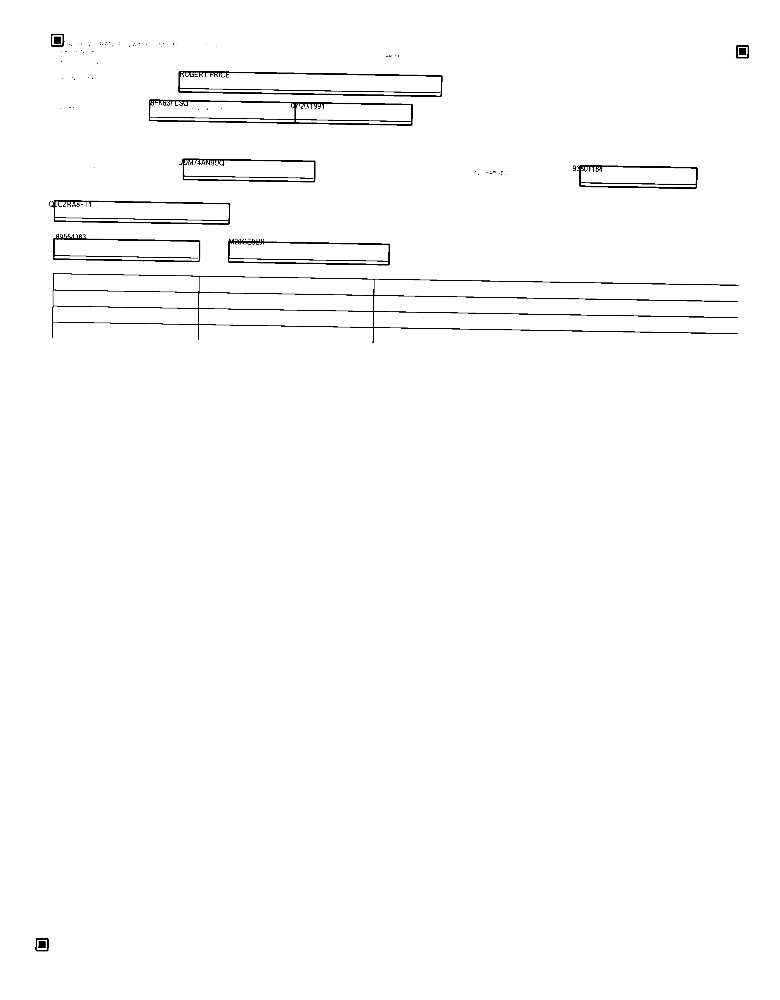
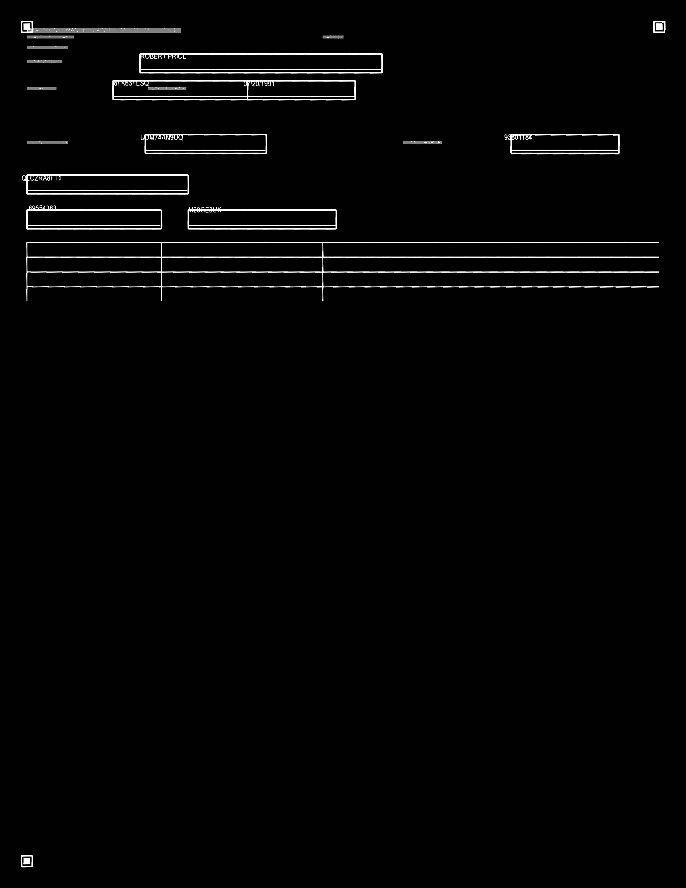

# Form dropout PoC — summary

Synthetic CMS-1500-style claim scans to test whether **edge-sensitive form dropout** improves field OCR compared to the operational baseline: **OCR on the field crop with form lines and labels still present** (no template removal).

## Problem

When typed or printed fill overlaps form rules and labels, naive “hole-punch” subtraction (delete every pixel where the template has ink) often **breaks characters at crossings** (classic B/P/E/F confusion). Edge-sensitive dropout uses run-length / extra-mass logic to remove form ink while **protecting** strokes that are thicker than the template alone at a crossing.

This PoC asks a narrower question: under **messy, production-like** conditions—not oracle alignment or ground-truth fonts—how much do we gain over **doing nothing**?

## What we compare

| Arm | Form removed? | Role |
|-----|----------------|------|
| **naive** | No | **Primary baseline** — current failure mode |
| **edge_dropout** | Yes (registered `F` + extra-mass) | **Hypothesis** — uplift |
| **naive_subtract** | Yes (dumb punch) | Secondary — smart vs dumb deletion |

## Production-like pipeline

1. **Synth form** — thick rules/boxes, optional overlap between fill and form mask `F`.
2. **Antagonistic scan** — scale/rotation/translation, blur, uneven illumination, speckle; dropout-color forms often **mis-threshold** to B&W.
3. **Registration** — fiducial geometry only (no ground-truth warp for OCR).
4. **Template `F`** — from **detected** form font + optional XOR shift refine (not generation mask).
5. **Per-field OCR** — Tesseract on naive, edge, and subtract crops vs synthetic ground-truth fill.

Oracle paths (GT affine, GT font for dropout) are **out of scope** for scoring.

## Batch results (seed 42, n=48)

| Metric | Value | Notes |
|--------|------:|-------|
| Fields scored | 384 | 8 fields × 48 samples |
| **Exact match — naive** | 0% | Tesseract + noise |
| **Exact match — edge** | 0% | No naive-wrong → edge-exact rescues in this run |
| **Mean CER — naive** | 1.03 | |
| **Mean CER — edge** | 0.98 | |
| **CER delta (naive − edge)** | **+0.054** | Edge lower on average |
| Font detection accuracy | 44% | 3-font ID on label ROIs |
| Mean fiducial reproj | ~18 px | QA only; warp is still fiducial-only |

**Interpretation:** Under realistic registration and font-ID error, we do **not** see exact-match uplift, but mean CER still favors edge dropout. That is a **valid negative/partial result**—worth reporting honestly rather than inflating metrics with oracle alignment.

Stratified detail: run the pipeline and inspect `artifacts/summary.json` (`by_ink_mode`, `by_overlap_bucket`, `by_reg_error_quartile`, `fragile`).

## Showcase example (`sample_0045`, patient name)

Fill crosses the **top rule** of the name box; naive OCR collapses to garbage; edge dropout strips the box while keeping letter strokes at the crossing.

**Ground truth:** `ROBERT PRICE` · **Overlap:** ~32% · **Scan mode:** `dropout_bw`

| Arm | Tesseract read | CER vs GT |
|-----|----------------|----------:|
| naive | `EE` | 0.83 |
| edge_dropout | `RUBERTPRICE` | **0.17** |
| naive_subtract | `KUBERTPRILE Z L` | worse (ascenders damaged) |

### Full scan



### Field crops (same registration)

| Naive (form ink present) | Edge dropout |
|--------------------------|--------------|
|  |  |

Registration overlay (aligned scan + detected template):



More detail: [`examples/showcase_sample_0045/README.md`](examples/showcase_sample_0045/README.md).

## Run locally

```bash
cd form_dropout_poc
python3 -m venv .venv && source .venv/bin/activate
pip install -r requirements.txt
brew install tesseract   # macOS

PYTHONPATH=src python -m form_dropout_poc.pipeline --n 48 --seed 42
```

Outputs under `artifacts/` (gitignored); regenerate the showcase from `artifacts/sample_0045/` after a batch run.

## Repo layout

| Path | Purpose |
|------|---------|
| `src/form_dropout_poc/` | Synth, scan sim, register, font ID, dropout, OCR, eval |
| `examples/showcase_sample_0045/` | Checked-in images for the story above |
| `README.md` | Setup and metric glossary |
| `SUMMARY.md` | This document |

## Out of scope (for this PoC)

Real CMS PDFs, handwriting, full glyph MAP, elastic warp, oracle OCR scoring columns.
